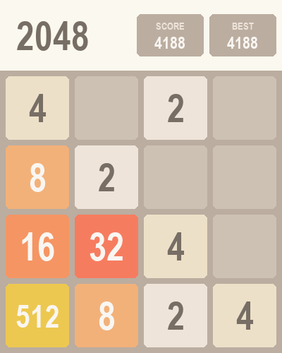
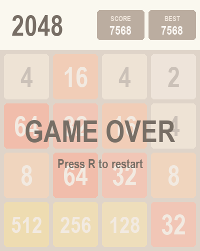

# 2048

The classic sliding-tile puzzle, made with Python and pygame.

 

## How to play

Slide the tiles with the arrow keys. When two tiles with the same number touch, they merge into one. Reach **2048** to win!

| Key | Action |
| --- | --- |
| Arrow keys / WASD | Move the tiles |
| R | Restart |
| C | Keep playing after you win |

Your best score is saved between games.

## Run it

```
pip install pygame-ce
python main.py
```
